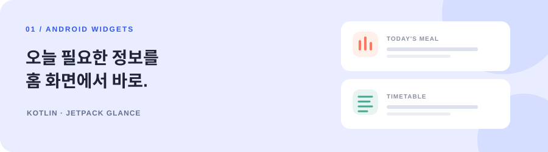
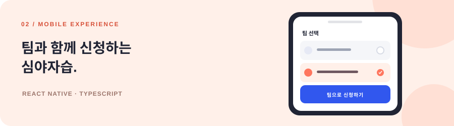
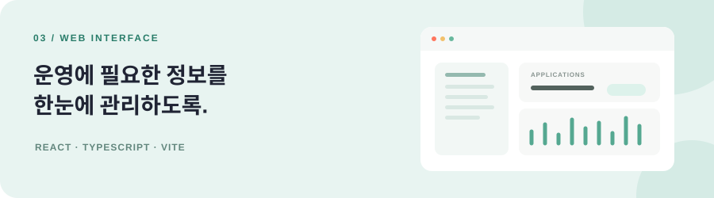

  

# 안녕하세요, 박현준입니다 👋

**매일 쓰는 앱의 작은 불편을 더 나은 경험으로 바꿉니다.**

Android와 React Native를 중심으로 앱 기능을 만들고, React와 TypeScript로 웹 경험도 구현합니다.  
위젯부터 인증 흐름까지 실제 사용 맥락을 살피며 제품을 다듬고 있습니다.

 

01 &nbsp; / &nbsp; ABOUT

## 만드는 일

|  |  |  |
| :--- | :--- | :--- |
| 앱 밖에서도 바로 확인하는 **홈 화면 위젯** | 사용자 흐름을 매끄럽게 만드는 **모바일 기능** | 팀의 일을 간단히 만드는 **관리 화면** |
| Kotlin · Jetpack Glance | React Native · Expo | React · TypeScript |

 

02 &nbsp; / &nbsp; TEAMS

## 함께한 팀

<table>
<tr>
<td width="50%" valign="top">

<h3>B1nd 도담도담</h3>

학생들의 학교생활을 돕는 서비스를 만들고 있습니다.

급식·시간표 Android 위젯 팀 단위 심야자습 신청 기능 심야자습 운영 웹 화면

<code>Kotlin</code> <code>React Native</code> <code>React</code>

<a href="https://github.com/Team-B1ND">조직 페이지 보기 ↗</a>
</td>
<td width="50%" valign="top">

<h3>C0nnect Qvick</h3>

출석과 기숙사 생활을 더 편리하게 만드는 플랫폼입니다.

모바일 출석 화면과 상태 표시 로그인 유지와 인증 흐름 개선 Android 태블릿 앱 개발

<code>React Native</code> <code>Expo</code> <code>Kotlin</code>

<a href="https://github.com/Team-C0nnect">조직 페이지 보기 ↗</a>
</td>
</tr>
</table>

 

03 &nbsp; / &nbsp; SELECTED WORK

## 대표 작업

<table>
<tr>
<td width="50%" valign="top">

<h3>필요한 정보를 홈 화면에서</h3>

크기에 따라 달라지는 급식·시간표 위젯과 데이터 갱신, 테마, 미리보기를 구현했습니다.

KOTLIN · JETPACK GLANCE  
<a href="https://github.com/Team-B1ND/dodamdodam-app/pull/70">위젯 개발 PR ↗</a>
</td>
<td width="50%" valign="top">

<h3>팀으로 신청하는 심야자습</h3>

팀 선택과 팀원 표시를 연결하고 중복 선택을 막아 신청 흐름을 개선했습니다.

REACT NATIVE · TYPESCRIPT  
<a href="https://github.com/Team-B1ND/dodamdodam-app/pull/52">팀 선택 기능 ↗</a> · <a href="https://github.com/Team-B1ND/dodamdodam-app/pull/61">화면 개선 ↗</a>
</td>
</tr>
<tr>
<td colspan="2" valign="top">

<h3>운영 정보를 한눈에 보는 웹 화면</h3>

심야자습 관리 UI와 상세 화면을 만들고, 팀·학생 정보를 불러오는 데이터 흐름을 연결했습니다.

REACT · TYPESCRIPT · VITE  
<a href="https://github.com/Team-B1ND/dodam-aid-nightstudy/pull/6">웹 화면 PR ↗</a>
</td>
</tr>
</table>

 

04 &nbsp; / &nbsp; TOOLKIT

## 기술 스택

**모바일**  
    

**웹**  
   

**연동과 도구**  
`Axios`　`REST API`　`JWT`　`FCM`　`Git`　`GitHub`　`Android Studio`

 

05 &nbsp; / &nbsp; OUTSIDE WORK

## 개인 프로젝트와 학습

| 프로젝트 | 한 줄 소개 | 기술 |
| :--- | :--- | :--- |
| [TodoList](https://github.com/parkhj2009/TodoList) | Android 할 일 관리 앱 | Kotlin |
| [todolist_web](https://github.com/parkhj2009/todolist_web) | 웹 기반 할 일 목록 | JavaScript |
| [Seats](https://github.com/parkhj2009/Seats) | 좌석 관련 프로젝트 | Python |
| [react_study](https://github.com/parkhj2009/react_study) | React 학습 기록 | React |

 

---

### 함께 만들고, 더 나은 사용 경험을 고민합니다.

새로운 아이디어나 협업 이야기를 나누고 싶다면 편하게 연락 주세요.

[이메일 보내기 ↗](mailto:eee0110010100@gmail.com) &nbsp; · &nbsp; [모든 저장소 보기 ↗](https://github.com/parkhj2009?tab=repositories)

