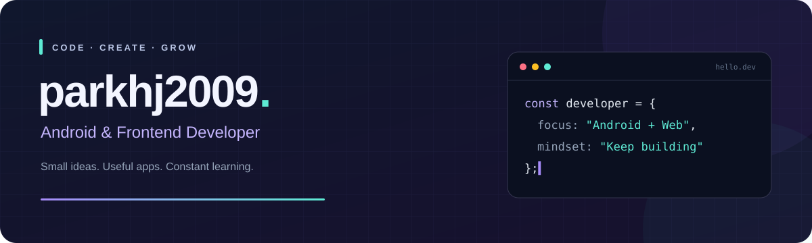

 

**작은 호기심을 코드로, 배움을 기록으로.**

안녕하세요, **박현준**입니다.  
깔끔한 UI와 실용적인 서비스를 좋아하며, Android와 Web을 만들고 있습니다.

 

### ✦ About me

| 📱 Android | 🌐 Frontend | 🌱 Learning |
| :--- | :--- | :--- |
| Kotlin으로 앱 만들기 | React로 웹 화면 구현하기 | 직접 만들면서 배우기 |
| 일상에 도움이 되는 기능 | 깔끔하고 사용하기 편한 UI | 작은 기능부터 꾸준히 완성 |

 

### ✦ Organizations

<table>
  <tr>
    <td align="center" width="50%">
      <a href="https://github.com/Team-B1ND">
        
         <strong>B1nd</strong>
      </a>
        
      스마트 학생 생활 관리 시스템 
      <strong>도담도담</strong>
        
      <a href="https://github.com/Team-B1ND">Explore organization ↗</a>
    </td>
    <td align="center" width="50%">
      <a href="https://github.com/Team-C0nnect">
        
         <strong>C0nnect</strong>
      </a>
        
      스마트한 출석체크 · 기숙사 관리 플랫폼 
      <strong>Qvick</strong>
        
      <a href="https://github.com/Team-C0nnect">Explore organization ↗</a>
    </td>
  </tr>
</table>

 

### ✦ Tech stack

**Languages**

**Frameworks & Tools**

 

### ✦ Selected projects

| 프로젝트 | 주요 언어 | 둘러보기 |
| :--- | :--- | :---: |
| **📱 TodoList** | `Kotlin` | [Repository ↗](https://github.com/parkhj2009/TodoList) |
| **🌐 todolist_web** | `JavaScript` | [Repository ↗](https://github.com/parkhj2009/todolist_web) |
| **🪑 Seats** | `Python` | [Repository ↗](https://github.com/parkhj2009/Seats) |

[전체 프로젝트 보기 →](https://github.com/parkhj2009?tab=repositories)

 

### ✦ Learning journal

> **배운 것을 직접 만들며 내 것으로.**  
> 코드를 작성하고, 작은 기능을 완성하며 배워갑니다.

 

---

Thanks for visiting · Let's build something useful.

